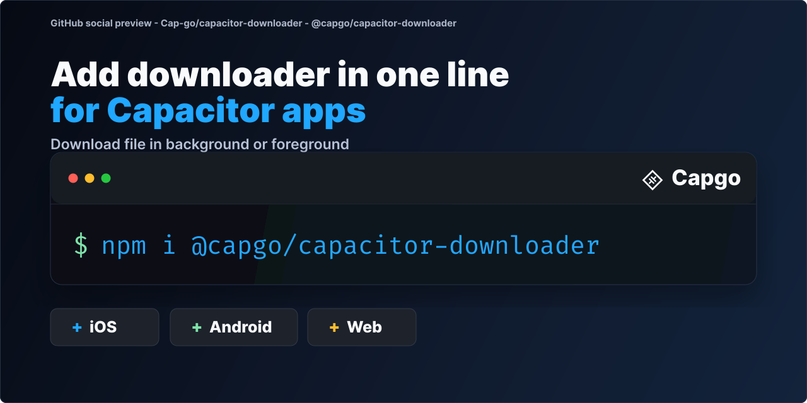

# @capgo/capacitor-downloader

Download large files in the background or foreground from your Capacitor app, with pause, resume and progress events. Downloads keep going when users leave the screen.

<a href="https://capgo.app/?ref=plugin_downloader"></a>

<div align="center">
  <p><b>Capgo</b>: push fixes to your Capacitor users in minutes, build signed iOS and Android apps without a Mac, and roll back in one click.</p>
  <h2><a href="https://capgo.app/register/?ref=plugin_downloader">➡️ Get started for free</a></h2>
  <p>14-day unlimited free trial. No credit card required</p>
</div>

> 🤖 **Building with an AI coding agent?** Install [Capgo skills](https://capgo.app/skills/?ref=plugin_downloader) so Claude Code, Codex, Cursor, Copilot, or Gemini CLI know how to install and use `@capgo/capacitor-downloader` in your Capacitor app: `npx skills add Cap-go/capgo-skills`. Then ask your agent: *"Add @capgo/capacitor-downloader to my Capacitor app and wire it up."* [Agent setup guides](https://capgo.app/agents/?ref=plugin_downloader) · [Hosted MCP](https://capgo.app/docs/ai/mcp/?ref=plugin_downloader)

<p align="center">
  
</p>

## Built and maintained with AI

We build, improve and fix our plugins with heavy use of AI, so issues usually get fixed in under a day and pull requests get feedback the same day. A human still reviews, tests and merges 50+ pull requests daily.

- Most plugin issues get a fix pull request the same day, often within a couple of hours, and are usually resolved in one to two days.
- Every pull request goes through our AI review system, usually within minutes.
- Our AI pre-checks tests, code review, conventions and security, then a human reviews, tests and merges.
- A human, Martin, reviews, tests and merges 50+ pull requests every day.
- In the last 90 days, 95% of plugin issues were resolved.

[Learn more about how we build with AI](https://capgo.app/docs/plugins/ai-engineering/)

## Robust background downloads (offline packs)

Use this when users fetch several large files and keep using other apps:

- **iOS**: background `URLSession` instances warm up at launch. Wire `CapacitorDownloaderLifecycle` in `AppDelegate` (see below) so `handleEventsForBackgroundURLSession` finishes relaunched work.
- **iOS paths**: `files/...` and `cache/...` stay under Documents as in 8.7.0. Use `private/...` (iOS only) for Application Support. Reject `..` in path segments.
- **iOS 26+**: set `iosContinuedProcessing: true` to run the download in a continued-processing task that shows `title` and `description` while the device is locked. If it expires, the download is cancelled (not resumed on relaunch).
- **Android OkHttp**: default `notification: 'completed'` matches 8.7.0 (no ongoing notification, no foreground service). Set `notification: 'progress'` to opt in to ongoing progress and an optional `dataSync` foreground service (minSdk 24; Android 12+ may block background starts). Downloads continue if the service cannot start. The manifest merges `POST_NOTIFICATIONS`; on Android 13+ request it at runtime when you use `'progress'`.
- **Multi-file batches (8.12.0)**: same background options apply to a batch `id`. On iOS set `iosContinuedProcessing: true` for one continued processing task for the whole batch. On Android, when every file resolves to OkHttp (`cache/...`, `files/...`, or `'okhttp'`), set `notification: 'progress'` for one shared progress notification and optional foreground service for the batch.

```typescript
await CapacitorDownloader.download({
  id: 'offline-pack',
  url: mapPackUrl,
  destination: 'files/offline/pack.zip',
  androidHttpEngine: 'auto',
  notification: 'progress',
  title: 'Offline maps',
  description: 'Downloading map data',
  iosContinuedProcessing: true,
  downloadCompletedNotificationText: 'Maps are ready',
});
```

### iOS `AppDelegate` wiring

Forward background URL session events from `AppDelegate` (required for relaunch completion; warmup alone is not enough):

```swift
import CapacitorDownloaderPlugin // SPM. CocoaPods: import CapgoCapacitorDownloader

func application(_ application: UIApplication, didFinishLaunchingWithOptions ...) -> Bool {
  CapacitorDownloaderLifecycle.warmUpBackgroundSessions()
  return true
}

func application(_ application: UIApplication,
                 handleEventsForBackgroundURLSession identifier: String,
                 completionHandler: @escaping () -> Void) {
  CapacitorDownloaderLifecycle.handleEventsForBackgroundURLSession(
    identifier: identifier,
    completionHandler: completionHandler
  )
}
```

For `iosContinuedProcessing`, add a permitted identifier prefix to `Info.plist`:

```xml
<key>BGTaskSchedulerPermittedIdentifiers</key>
<array>
  <string>$(PRODUCT_BUNDLE_IDENTIFIER).CapacitorDownloader.continuedProcessing.*</string>
</array>
```

(Documentation: https://capgo.app/docs/plugins/downloader/)

## `lengthHeader` for gzip and compressed responses

> **Use this when:** the server sends `Content-Encoding: gzip` (or similar), `Content-Length` is missing or reflects **compressed** bytes, and your CDN still exposes the **uncompressed** size in a custom header (for example `X-Uncompressed-Length`).

Without `lengthHeader`, `downloadProgress` can sit at `0`, jump early to `1`, or report `bytesTotal` that does not match the file on disk. With `lengthHeader`, native code reads that header from the HTTP response and uses it for progress totals. Progress is always clamped at `1`.

Do not add `Accept-Encoding: gzip` (or similar) to `headers`. That disables OkHttp transparent decompression on Android and leaves `Content-Encoding` on the response, so Android OkHttp ignores `lengthHeader` and progress can stall.

| Scope | `lengthHeader` |
| --- | --- |
| Single download, iOS | Supported |
| Single download, Android OkHttp | `androidHttpEngine: 'okhttp'` or `'auto'` on app-private paths |
| Batch download, iOS | Supported (one header name for every file in `files`) |
| Batch download, Android OkHttp | Same as single OkHttp (every file resolves to OkHttp) |
| Batch download, Android DownloadManager | Ignored |
| Android DownloadManager (single) | Ignored |
| Web | Ignored |

```typescript
import { CapacitorDownloader } from '@capgo/capacitor-downloader';

await CapacitorDownloader.addListener('downloadProgress', (event) => {
  console.log(event.id, event.progress, event.bytesTotal, event.bytesWritten);
});

await CapacitorDownloader.download({
  id: 'gzip-pack',
  url: 'https://cdn.example.com/bundle.tar.gz',
  destination: 'files/updates/bundle.tar.gz',
  androidHttpEngine: 'okhttp',
  lengthHeader: 'X-Uncompressed-Length',
});
```

On iOS, batch downloads share one `lengthHeader` name for every file in `files`. On Android, OkHttp batches honor the same header on every file; DownloadManager batches ignore it.

Full docs: [Capgo downloader guide](https://capgo.app/docs/plugins/downloader/getting-started/#lengthheader-for-gzip-downloads) (once released on the website). Tracked with [capacitor-downloader#144](https://github.com/Cap-go/capacitor-downloader/pull/144).

## Retry after connection failures

> **Use this when:** mobile networks drop mid-transfer and you want the plugin to restart the file after a transport error without rebuilding your own backoff loop.

Set `retries` on `download()` (default `0`). Each retry downloads the file again from the start after a delay of 5 seconds times the attempt number (5 s, then 10 s, then 15 s, and so on, capped at 10 minutes). Progress for that file resets to `0` when a retry starts. HTTP errors, cancellation, and file-system errors are not retried.

| Scope | `retries` |
| --- | --- |
| Single download, Android OkHttp | `androidHttpEngine: 'auto'` or `'okhttp'` on app-private paths |
| Single download, iOS | URLSession (foreground and background) |
| Batch download, iOS | Applied per file; other files keep running |
| Android DownloadManager (single or batch) | Ignored |
| Web | Ignored |

Optional `downloadFailedNotificationText` shows a localized system notification when a download or batch ends in failure (same notification slot as `downloadCompletedNotificationText`; not shown after `stop()`).

```typescript
import { CapacitorDownloader } from '@capgo/capacitor-downloader';

await CapacitorDownloader.download({
  id: 'episode',
  url: 'https://cdn.example.com/episode.mp4',
  destination: 'files/episodes/episode.mp4',
  androidHttpEngine: 'auto',
  retries: 3,
  downloadFailedNotificationText: 'Download failed',
  downloadCompletedNotificationText: 'Episode is ready',
});
```

Website docs: [Connection failure retries](https://capgo.app/docs/plugins/downloader/getting-started/#connection-failure-retries) (patch for Cap-go/website ships with [capacitor-downloader#153](https://github.com/Cap-go/capacitor-downloader/pull/153)).

## Key features

- **Downloads**: `download()` starts a task with optional HTTP headers and a `wifi-only` or cellular network rule.
- **Control**: `pause()`, `resume()` and `stop()` for each download ID.
- **Progress events**: `downloadProgress`, `downloadCompleted` and `downloadFailed` listeners.
- **Status and files**: `checkStatus()` for a task and `getFileInfo()` for a downloaded file.
- **Platforms**: iOS and Android. iOS uses a background `URLSession`. Android uses `DownloadManager` by default (same as earlier releases). **OkHttp** is opt in via `androidHttpEngine` for app-private destinations. Not available on web.
- **Android private storage**: set `androidHttpEngine: 'auto'` or `'okhttp'` and use `cache/...` or `files/...` for internal storage. `notification: 'hidden'` hides DownloadManager progress UI; `downloadCompletedNotificationText` can still alert on success.
- **Batch downloads (8.7.0)**: pass `files` on `download()` to let native code own a multi-file batch (overall plus per-file progress, one completion when all succeed). There is no fixed file cap. On Android, batches run through OkHttp when every file resolves to it (see **Multi-file batches (8.12.0)** above). Android single-file OkHttp downloads and all-OkHttp batches share one fair queue capped at 4 concurrent transfers. iOS URLSession queues work per host. The exported `DOWNLOAD_BATCH_MAX_FILES` constant is deprecated, not enforced, and will be removed in the next major.
- **Android notification copy (8.6.0)**: optional `title` and `description` on DownloadManager progress notifications. With `iosContinuedProcessing: true` (iOS 26+), the same fields label the continued-processing task. Ignored on Web and on transfers that do not show those UIs (for example OkHttp without DownloadManager).
- **Connection retries (8.9.0)**: optional `retries` on OkHttp (Android) and URLSession (iOS); optional `downloadFailedNotificationText` for failure alerts.

## Multi-file batch downloads

For several large assets, start one batch instead of many independent downloads. The top-level `id` is the batch id. Each entry in `files` needs `url` and `destination`. Shared options such as `headers`, `network`, and `notification` apply to every file in the batch.

```typescript
import { CapacitorDownloader } from '@capgo/capacitor-downloader';

await CapacitorDownloader.addListener('downloadProgress', (event) => {
  console.log(event.id, event.progress, event.fileIndex, event.fileProgress);
});

await CapacitorDownloader.download({
  id: 'offline-pack',
  files: [
    { url: 'https://example.com/a.zip', destination: 'pack/a.zip' },
    { url: 'https://example.com/b.zip', destination: 'pack/b.zip' },
  ],
  notification: 'hidden',
});
```

`downloadProgress` uses `progress` and `fileProgress` from 0 to 1 (same scale as single downloads and `checkStatus`). Events also include `fileIndex` while a batch is running. `downloadCompleted` fires once when every file succeeds. If any file fails, the plugin emits `downloadFailed` for the batch id (with `fileIndex` when known) and cancels the rest. Files that already finished successfully stay on disk; only remaining transfers are cancelled.

**`stop()` on a batch:** On iOS, deletes paths recorded by `recordMovedDestination` for that batch (including files that finished before `stop()`). Batch failure alone does not remove those paths. On Android, removes active DownloadManager entries for in-flight children; completed batch files stay on disk.

**Pause and resume:** iOS supports `pause()` and `resume()` on the batch id. Android rejects pause and resume for batches and single downloads (use `stop()`).

**Process death:** On Android, batch state is memory-only and is lost when the process is killed. DownloadManager batch work may still finish in the system, but the plugin does not rebuild batch progress. OkHttp batch transfers stop when the process is killed and are not resumed. On iOS, batch metadata is persisted and restored when the plugin loads (`DownloadBatchStore` / `DownloadBatchCoordinator`).

## Android OkHttp engine (8.5.0)

**Opt in:** set `androidHttpEngine` to `'auto'` or `'okhttp'` for downloads into app-private storage (offline packs, encrypted assets, cache). When the option is omitted, every destination uses `DownloadManager` and legacy app external file paths, including existing `cache/...` and `files/...` strings.

```typescript
await CapacitorDownloader.download({
  id: 'offline-pack',
  url: 'https://cdn.example.com/pack.zip',
  destination: 'files/offline/pack.zip',
  androidHttpEngine: 'auto', // OkHttp for files/... and cache/...
  notification: 'hidden', // no system notification during transfer; listen to downloadProgress
});
```

| `androidHttpEngine` | Behavior |
| ------------------- | -------- |
| Omitted | DownloadManager only, legacy destination paths (matches pre-option releases) |
| `'auto'` | OkHttp for `cache/...`, `files/...`, and paths under internal cache/data/files; DownloadManager for external app storage and `public-downloads/...` |
| `'okhttp'` | Always OkHttp; rejects `public-downloads/...` paths |
| `'downloadManager'` | Always system DownloadManager with legacy destination paths |

**Android `destination` prefixes**

| Prefix | Storage when `androidHttpEngine` is `'auto'` or `'okhttp'` | Storage when option is omitted |
| ------ | ----------------------------------------------------------- | ------------------------------ |
| `cache/...` | App cache dir (OkHttp with `'auto'`) | App external files (DownloadManager) |
| `files/...` | App-private files dir (OkHttp with `'auto'`) | App external files (DownloadManager) |
| `public-downloads/...` | Public Downloads folder (DownloadManager) | App external files under `public-downloads/...` (DownloadManager) |
| Other relative paths | App external files dir (DownloadManager) | App external files dir (DownloadManager) |

**Notifications on OkHttp (8.8.0):** Only `notification: 'progress'` opts in to ongoing progress and the optional `dataSync` foreground service. Default `'completed'` matches 8.7.0, including one "Download complete" notification on success via `DownloadCompletionNotifier`. `downloadCompletedNotificationText` is unchanged.

**iOS paths (8.8.0):** `files/` and `cache/` still resolve under Documents. New `private/` prefix (iOS only) writes under Application Support/CapacitorDownloader/.

Full guide: https://capgo.app/docs/plugins/downloader/getting-started/#android-okhttp-engine

## Android DownloadManager notification title and description (8.6.0)

**Available since 8.6.0:** set `title` and `description` on `download()` so the Android DownloadManager progress notification shows a user-facing label instead of the raw destination file name. Omit either field (or pass empty text) to keep the system default. Applies only on the DownloadManager path; iOS, Web, and OkHttp Android downloads ignore both options.

```typescript
await CapacitorDownloader.download({
  id: 'offline-pack',
  url: 'https://cdn.example.com/large-pack.zip',
  destination: 'downloads/offline-pack.zip',
  notification: 'progress',
  title: 'Offline map pack',
  description: 'Downloading region data for offline use',
});
```

Full guide: https://capgo.app/docs/plugins/downloader/getting-started/#android-downloadmanager-notification-labels

## Download completed notifications

Long downloads often finish while your user is in another app. Set `downloadCompletedNotificationText` on `download()` to show an opt-in, caller-localized system notification when the file is ready. Tapping it returns to your app.

- **Opt in**: omit the option (or pass empty text) to rely on `downloadCompleted` events only.
- **Permissions**: request notification permission in your app. If the user denies it, downloads still complete and the plugin skips the alert.
- **Android**: the plugin manifest already merges `POST_NOTIFICATIONS`; on Android 13+ your app only needs to request it at runtime. Works alongside the DownloadManager `notification` visibility option. While your app is in the foreground, Android still posts the completion alert when the download succeeds.
- **iOS**: request authorization with `UNUserNotificationCenter` before the download finishes. While your app is in the foreground, iOS shows a delivered notification only if your app's `UNUserNotificationCenter` delegate presents it, so without a notifications plugin it is usually silent; use `downloadCompleted` events in that case.

```typescript
await Downloader.download({
  id: 'episode-12',
  url: audioUrl,
  destination: 'podcasts/episode-12.mp3',
  notification: 'hidden',
  downloadCompletedNotificationText: t('downloads.episodeReady'),
});
```

## Why Capacitor Downloader?

A reliable **native file downloader** built for Capacitor apps that continues downloads even when your app is backgrounded or closed:

- **Background downloads** - Downloads continue even when app is minimized, backgrounded, or closed (main advantage)
- **Progress tracking** - Real-time progress updates during downloads
- **Network control** - Choose between WiFi-only or cellular network downloads
- **Custom headers** - Add authentication tokens and custom HTTP headers
- **Resumable downloads** - Pause and resume downloads (platform dependent)
- **Event listeners** - Monitor download progress, completion, and failures
- **Large file support** - Handle multi-gigabyte files without memory issues
- **Free and open source** - No paid services required

Perfect for downloading large media files, offline content, app updates, and any scenario where downloads need to survive app lifecycle events.

## Documentation

The most complete doc is available here: https://capgo.app/docs/plugins/downloader/

## Compatibility

| Plugin version | Capacitor compatibility | Maintained |
| -------------- | ----------------------- | ---------- |
| v8.\*.\*       | v8.\*.\*                | ✅          |
| v7.\*.\*       | v7.\*.\*                | On demand   |
| v6.\*.\*       | v6.\*.\*                | ❌          |
| v5.\*.\*       | v5.\*.\*                | ❌          |

> **Note:** The major version of this plugin follows the major version of Capacitor. Use the version that matches your Capacitor installation (e.g., plugin v8 for Capacitor 8). Only the latest major version is actively maintained.

## Install

You can use our AI-Assisted Setup to install the plugin. Add the Capgo skills to your AI tool using the following command:

```bash
npx skills add https://github.com/cap-go/capacitor-skills --skill capacitor-plugins
```

Then use the following prompt:

```text
Use the `capacitor-plugins` skill from `cap-go/capacitor-skills` to install the `@capgo/capacitor-downloader` plugin in my project.
```

If you prefer Manual Setup, install the plugin by running the following commands and follow the platform-specific instructions below:

```bash
npm install @capgo/capacitor-downloader
npx cap sync
```

## API

<docgen-index>

* [`download(...)`](#download)
* [`pause(...)`](#pause)
* [`resume(...)`](#resume)
* [`stop(...)`](#stop)
* [`checkStatus(...)`](#checkstatus)
* [`getFileInfo(...)`](#getfileinfo)
* [`addListener('downloadProgress', ...)`](#addlistenerdownloadprogress-)
* [`addListener('downloadCompleted', ...)`](#addlistenerdownloadcompleted-)
* [`addListener('downloadFailed', ...)`](#addlistenerdownloadfailed-)
* [`removeAllListeners()`](#removealllisteners)
* [`getPluginVersion()`](#getpluginversion)
* [Interfaces](#interfaces)

</docgen-index>

<docgen-api>
<!--Update the source file JSDoc comments and rerun docgen to update the docs below-->

Capacitor plugin for downloading files with background support.
Provides resumable downloads with progress tracking.

### download(...)

```typescript
download(options: DownloadOptions | DownloadBatchOptions) => Promise<DownloadTask>
```

Start a new download task.

| Param         | Type                                                                                                                    | Description              |
| ------------- | ----------------------------------------------------------------------------------------------------------------------- | ------------------------ |
| **`options`** | <code><a href="#downloadoptions">DownloadOptions</a> \| <a href="#downloadbatchoptions">DownloadBatchOptions</a></code> | - Download configuration |

**Returns:** <code>Promise&lt;<a href="#downloadtask">DownloadTask</a>&gt;</code>

--------------------


### pause(...)

```typescript
pause(options: { id: string; }) => Promise<void>
```

Pause an active download.
Download can be resumed later from the same position.

iOS supports pause and resume for single downloads and batches. Android rejects pause and resume for every download, including batches (use `stop()` instead).

| Param         | Type                         | Description                               |
| ------------- | ---------------------------- | ----------------------------------------- |
| **`options`** | <code>{ id: string; }</code> | - Options containing the download task ID |

--------------------


### resume(...)

```typescript
resume(options: { id: string; }) => Promise<void>
```

Resume a paused download.
Continues from where it was paused.

iOS supports pause and resume for single downloads and batches. Android rejects pause and resume for every download, including batches.

| Param         | Type                         | Description                               |
| ------------- | ---------------------------- | ----------------------------------------- |
| **`options`** | <code>{ id: string; }</code> | - Options containing the download task ID |

--------------------


### stop(...)

```typescript
stop(options: { id: string; }) => Promise<void>
```

Stop and cancel a download permanently.

**Single downloads:** Cancels the transfer. Platform cleanup depends on the OS; the plugin does not guarantee file removal for singles.

**Batch id on iOS:** Deletes each path recorded by `recordMovedDestination` for that batch. Batch failure alone does not delete finished files.

**Batch id on Android:** Removes DownloadManager work for non-finished children. Completed batch files (marked complete or `STATUS_SUCCESSFUL` in DownloadManager) stay on disk.

| Param         | Type                         | Description                               |
| ------------- | ---------------------------- | ----------------------------------------- |
| **`options`** | <code>{ id: string; }</code> | - Options containing the download task ID |

--------------------


### checkStatus(...)

```typescript
checkStatus(options: { id: string; }) => Promise<DownloadTask>
```

Check the current status of a download.

Reports active URLSession/OkHttp/DownloadManager work. On iOS, batch child ids also resolve from in-memory
batch progress while that batch row exists. Completed batches unregister their children, so `checkStatus`
may reject with "Task not found" after success.

| Param         | Type                         | Description                               |
| ------------- | ---------------------------- | ----------------------------------------- |
| **`options`** | <code>{ id: string; }</code> | - Options containing the download task ID |

**Returns:** <code>Promise&lt;<a href="#downloadtask">DownloadTask</a>&gt;</code>

--------------------


### getFileInfo(...)

```typescript
getFileInfo(options: { path: string; }) => Promise<{ size: number; type: string; }>
```

Get information about a downloaded file.

| Param         | Type                           | Description                        |
| ------------- | ------------------------------ | ---------------------------------- |
| **`options`** | <code>{ path: string; }</code> | - Options containing the file path |

**Returns:** <code>Promise&lt;{ size: number; type: string; }&gt;</code>

--------------------


### addListener('downloadProgress', ...)

```typescript
addListener(eventName: 'downloadProgress', listenerFunc: (progress: { id: string; progress: number; bytesWritten?: number | undefined; bytesTotal?: number | undefined; fileIndex?: number | undefined; fileProgress?: number | undefined; }) => void) => Promise<PluginListenerHandle>
```

Listen for download progress updates.
Fired periodically as download progresses.

For batch downloads, `progress` and `fileProgress` use the same 0 to 1 scale as <a href="#downloadtask">DownloadTask</a>.

| Param              | Type                                                                                                                                                         | Description                           |
| ------------------ | ------------------------------------------------------------------------------------------------------------------------------------------------------------ | ------------------------------------- |
| **`eventName`**    | <code>'downloadProgress'</code>                                                                                                                              | - Must be 'downloadProgress'          |
| **`listenerFunc`** | <code>(progress: { id: string; progress: number; bytesWritten?: number; bytesTotal?: number; fileIndex?: number; fileProgress?: number; }) =&gt; void</code> | - Callback receiving progress updates |

**Returns:** <code>Promise&lt;<a href="#pluginlistenerhandle">PluginListenerHandle</a>&gt;</code>

--------------------


### addListener('downloadCompleted', ...)

```typescript
addListener(eventName: 'downloadCompleted', listenerFunc: (result: { id: string; }) => void) => Promise<PluginListenerHandle>
```

Listen for download completion.
Fired when a download finishes successfully.

| Param              | Type                                              | Description                                  |
| ------------------ | ------------------------------------------------- | -------------------------------------------- |
| **`eventName`**    | <code>'downloadCompleted'</code>                  | - Must be 'downloadCompleted'                |
| **`listenerFunc`** | <code>(result: { id: string; }) =&gt; void</code> | - Callback receiving completion notification |

**Returns:** <code>Promise&lt;<a href="#pluginlistenerhandle">PluginListenerHandle</a>&gt;</code>

--------------------


### addListener('downloadFailed', ...)

```typescript
addListener(eventName: 'downloadFailed', listenerFunc: (error: { id: string; error: string; fileIndex?: number | undefined; errorCode?: number | undefined; errorDomain?: string | undefined; }) => void) => Promise<PluginListenerHandle>
```

Listen for download failures.
Fired when a download encounters an error.

| Param              | Type                                                                                                                          | Description                            |
| ------------------ | ----------------------------------------------------------------------------------------------------------------------------- | -------------------------------------- |
| **`eventName`**    | <code>'downloadFailed'</code>                                                                                                 | - Must be 'downloadFailed'             |
| **`listenerFunc`** | <code>(error: { id: string; error: string; fileIndex?: number; errorCode?: number; errorDomain?: string; }) =&gt; void</code> | - Callback receiving error information |

**Returns:** <code>Promise&lt;<a href="#pluginlistenerhandle">PluginListenerHandle</a>&gt;</code>

--------------------


### removeAllListeners()

```typescript
removeAllListeners() => Promise<void>
```

Remove all event listeners.
Cleanup method to prevent memory leaks.

--------------------


### getPluginVersion()

```typescript
getPluginVersion() => Promise<{ version: string; }>
```

Get the plugin version number.

**Returns:** <code>Promise&lt;{ version: string; }&gt;</code>

--------------------


### Interfaces


#### DownloadTask

Represents the current state and progress of a download task.

| Prop                  | Type                                                                 | Description                                                                                                                                                                             |
| --------------------- | -------------------------------------------------------------------- | --------------------------------------------------------------------------------------------------------------------------------------------------------------------------------------- |
| **`id`**              | <code>string</code>                                                  | Unique identifier for the download task                                                                                                                                                 |
| **`progress`**        | <code>number</code>                                                  | Download progress from 0 to 1                                                                                                                                                           |
| **`state`**           | <code>'PENDING' \| 'RUNNING' \| 'PAUSED' \| 'DONE' \| 'ERROR'</code> | Current state of the download                                                                                                                                                           |
| **`batchGeneration`** | <code>number</code>                                                  | Batch-only metadata returned when `download()` starts a multi-file batch. `checkStatus()` applies to active transfers; after a batch tears down, child ids may return "Task not found". |
| **`childTaskIds`**    | <code>string[]</code>                                                | Ordered child task ids for batch entries (same order as `files`).                                                                                                                       |


#### DownloadOptions

Configuration options for starting a single-file download.

| Prop                                    | Type                                                 | Description                                                                                                                                                                                                                                                                                                                                                                                                                                                                                                                                                                                                                                                                                                                                                                                                                                                                                                         | Default        | Since |
| --------------------------------------- | ---------------------------------------------------- | ------------------------------------------------------------------------------------------------------------------------------------------------------------------------------------------------------------------------------------------------------------------------------------------------------------------------------------------------------------------------------------------------------------------------------------------------------------------------------------------------------------------------------------------------------------------------------------------------------------------------------------------------------------------------------------------------------------------------------------------------------------------------------------------------------------------------------------------------------------------------------------------------------------------- | -------------- | ----- |
| **`id`**                                | <code>string</code>                                  | Unique identifier for this download task                                                                                                                                                                                                                                                                                                                                                                                                                                                                                                                                                                                                                                                                                                                                                                                                                                                                            |                |       |
| **`url`**                               | <code>string</code>                                  | URL of the file to download                                                                                                                                                                                                                                                                                                                                                                                                                                                                                                                                                                                                                                                                                                                                                                                                                                                                                         |                |       |
| **`destination`**                       | <code>string</code>                                  | Local file path where the download will be saved. On Android, relative paths without `androidHttpEngine` behave like earlier releases: every relative path, including `cache/...` and `files/...`, is stored under app external files via DownloadManager. When you set `androidHttpEngine` to `'auto'` or `'okhttp'`, optional roots apply: - `cache/...` saves under app cache (OkHttp with `'auto'`). - `files/...` saves under app-private internal storage (OkHttp with `'auto'`). - `public-downloads/...` saves to the public Downloads folder (DownloadManager). - Any other relative path saves under app external files (DownloadManager with `'auto'`). Absolute paths and `file://` URIs are supported; `'auto'` picks OkHttp when the path is under cache, data, or files dirs. On iOS, optional roots match batch entries (see {@link <a href="#downloadfilespec">DownloadFileSpec.destination</a>}). |                |       |
| **`headers`**                           | <code>{ [key: string]: string; }</code>              | Optional HTTP headers to include in the request                                                                                                                                                                                                                                                                                                                                                                                                                                                                                                                                                                                                                                                                                                                                                                                                                                                                     |                |       |
| **`network`**                           | <code>'cellular' \| 'wifi-only'</code>               | Network type requirement for download                                                                                                                                                                                                                                                                                                                                                                                                                                                                                                                                                                                                                                                                                                                                                                                                                                                                               |                |       |
| **`priority`**                          | <code>'high' \| 'normal' \| 'low'</code>             | Download priority level                                                                                                                                                                                                                                                                                                                                                                                                                                                                                                                                                                                                                                                                                                                                                                                                                                                                                             |                |       |
| **`notification`**                      | <code>'completed' \| 'progress' \| 'hidden'</code>   | Android DownloadManager notification visibility. - `'completed'` (default): show while downloading and keep the notification after completion. - `'progress'`: show while downloading, remove the notification when finished. - `'hidden'`: no DownloadManager progress notification; use plugin progress events instead. `downloadCompletedNotificationText` can still post a completion notification when the transfer succeeds. On the OkHttp Android path, `'completed'` (default) keeps 8.7.0 behavior: no ongoing notification and no foreground service. Set `'progress'` to opt in to ongoing progress notifications and an optional `dataSync` foreground service (API 24+; may be blocked in the background on Android 12+). Downloads continue if the service cannot start. Android 13+ requires runtime `POST_NOTIFICATIONS` when notifications are shown. Ignored on iOS and Web.                      |                | 8.2.0 |
| **`title`**                             | <code>string</code>                                  | Title shown on the Android DownloadManager progress notification, and on iOS on the continued processing task when `iosContinuedProcessing` is set. When omitted or empty, DownloadManager uses its default (typically the destination file name). On Android OkHttp, used when `notification` is `'progress'`. iOS continued processing requires a non-empty `title`. Ignored on Web.                                                                                                                                                                                                                                                                                                                                                                                                                                                                                                                              |                | 8.6.0 |
| **`description`**                       | <code>string</code>                                  | Description shown on the Android DownloadManager progress notification, and on iOS as the subtitle of the continued processing task when `iosContinuedProcessing` is set. When omitted or empty, the system uses its default. On Android OkHttp, used when `notification` is `'progress'` (including OkHttp batches). Ignored on Web.                                                                                                                                                                                                                                                                                                                                                                                                                                                                                                                                                                               |                | 8.6.0 |
| **`androidHttpEngine`**                 | <code>'auto' \| 'okhttp' \| 'downloadManager'</code> | Android HTTP stack used for the download. - Omitted: always DownloadManager with legacy destination resolution (same as releases before this option). - `'auto'`: OkHttp for app-private destinations (`cache/...`, `files/...`, or an absolute path under cache/data/files when extended roots apply); DownloadManager for legacy relative paths under app external storage and `public-downloads/...`. - `'okhttp'`: always use OkHttp for extended-root destinations. Rejects `public-downloads/...` paths. Transfers run in the app process and do not continue after the process is killed (unlike DownloadManager on those paths). - `'downloadManager'`: always use the system DownloadManager with legacy destination resolution. Ignored on iOS and Web.                                                                                                                                                   |                | 8.5.0 |
| **`downloadCompletedNotificationText`** | <code>string</code>                                  | Optional localized text for a system notification when the download finishes. When set, iOS and Android may show a local notification after a successful download if the user granted notification permission. If permission is denied, the download still completes and no notification is shown. Tapping the notification reopens the app. Omitted or empty means no completion notification from the plugin (use `downloadCompleted` events while the app is open).                                                                                                                                                                                                                                                                                                                                                                                                                                              |                | 8.5.0 |
| **`downloadFailedNotificationText`**    | <code>string</code>                                  | Optional localized text for a system notification when the download fails. When set, iOS and Android may show a local notification after a failed download if the user granted notification permission. If permission is denied, the failure still occurs and no notification is shown. Tapping the notification reopens the app. Uses the same notification slot as `downloadCompletedNotificationText`, so a failure alert replaces a prior completion alert for the same download id instead of stacking. Not shown when the download is stopped by the app. Omitted or empty means no failure notification from the plugin (use `downloadFailed` events while the app is open).                                                                                                                                                                                                                                 |                | 8.9.0 |
| **`lengthHeader`**                      | <code>string</code>                                  | HTTP response header that carries the uncompressed byte length when the body is transferred compressed (for example `Content-Encoding: gzip`) and `Content-Length` is missing or wrong. When the response includes this header with a positive integer, native code uses it for `downloadProgress` totals and progress is clamped at 1. Examples: `X-Uncompressed-Length`. Single downloads: Android OkHttp and iOS. Ignored on Web and Android DownloadManager. On Android OkHttp, ignored when the response still includes `Content-Encoding` (for example after setting `Accept-Encoding: gzip` on the request). Do not set request `Accept-Encoding`; OkHttp handles decompression by default.                                                                                                                                                                                                                  |                | 8.9.0 |
| **`iosContinuedProcessing`**            | <code>boolean</code>                                 | iOS 26 and later: run the download in a `BGContinuedProcessingTask`, which shows `title` and `description` with the download progress while the device is locked. Requires `title`. Falls back to the background URL session when the task does not launch in time. If the task expires, the download fails with `downloadFailed` and is not resumed automatically. The host app must allow `$(PRODUCT_BUNDLE_IDENTIFIER).CapacitorDownloader.continuedProcessing.*` in `BGTaskSchedulerPermittedIdentifiers` (see plugin README). Ignored on Android and Web.                                                                                                                                                                                                                                                                                                                                                      |                | 8.9.0 |
| **`iosContinuedProcessingTitle`**       | <code>string</code>                                  | Title of the iOS continued processing task.                                                                                                                                                                                                                                                                                                                                                                                                                                                                                                                                                                                                                                                                                                                                                                                                                                                                         |                | 8.8.0 |
| **`iosContinuedProcessingSubtitle`**    | <code>string</code>                                  | Subtitle of the iOS continued processing task.                                                                                                                                                                                                                                                                                                                                                                                                                                                                                                                                                                                                                                                                                                                                                                                                                                                                      |                | 8.8.0 |
| **`retries`**                           | <code>number</code>                                  | Number of times to retry the file after a connection failure (OkHttp on Android and iOS URLSession). Defaults to `0` (no retries). On a retry, the file is downloaded again from the start after a delay of 5 seconds times the attempt number (5 s, then 10 s, then 15 s, and so on). Progress for the file resets to 0. HTTP errors, cancellation, and file-system errors are not retried. Android DownloadManager and Web ignore this option.                                                                                                                                                                                                                                                                                                                                                                                                                                                                    | <code>0</code> | 8.9.0 |
| **`files`**                             |                                                      | Multi-file batches use `files` instead. Omit for single-file downloads.                                                                                                                                                                                                                                                                                                                                                                                                                                                                                                                                                                                                                                                                                                                                                                                                                                             |                | 8.7.0 |


#### DownloadBatchOptions

Configuration options for a multi-file batch download.

On Android, each file uses the same `androidHttpEngine` destination rules as a single download. Since 8.12.0 a batch whose files all resolve to OkHttp runs through OkHttp, with one progress notification and optional foreground service for the whole batch when `notification` is `'progress'` (transfers continue if the service cannot start). A batch that mixes engines is rejected.

**Process death:** On Android, batch state lives in memory only and is lost when the host process is killed. DownloadManager batch work may still finish in the system, but the plugin does not rebuild batch progress. OkHttp batch transfers stop when the process is killed and are not resumed. On iOS, batch metadata is persisted in `DownloadBatchStore` (UserDefaults) and restored when the plugin initializes.

When one file fails, remaining transfers are cancelled. Files that already finished successfully stay on disk. On Android DownloadManager batches, completed children stop being tracked without calling DownloadManager.remove on them. On OkHttp batches, in-flight transfers are cancelled without deleting files that already finished.

**`stop({ id })` on a batch id:** On iOS, deletes every path stored via `recordMovedDestination` for that batch (files written before `stop()`). A later batch failure does not delete those paths; only `stop()` removes them. On Android DownloadManager batches, removes active DownloadManager entries for in-flight children; finished children stay on disk. On OkHttp batches, cancels in-flight transfers and removes their temp files; files from children that already finished stay on disk.

| Prop                                    | Type                                                 | Description                                                                                                                                                                                                                                                                                                                                                                                                                                                                                                                                                                                                                                                                                                                                                                                                                                                                                                                                  | Default        | Since  |
| --------------------------------------- | ---------------------------------------------------- | -------------------------------------------------------------------------------------------------------------------------------------------------------------------------------------------------------------------------------------------------------------------------------------------------------------------------------------------------------------------------------------------------------------------------------------------------------------------------------------------------------------------------------------------------------------------------------------------------------------------------------------------------------------------------------------------------------------------------------------------------------------------------------------------------------------------------------------------------------------------------------------------------------------------------------------------- | -------------- | ------ |
| **`id`**                                | <code>string</code>                                  | Unique identifier for this batch (shared by every file in `files`)                                                                                                                                                                                                                                                                                                                                                                                                                                                                                                                                                                                                                                                                                                                                                                                                                                                                           |                |        |
| **`files`**                             | <code>DownloadFileSpec[]</code>                      | Download multiple files as one native-owned batch. The batch shares the top-level `id`. Progress events use `progress` and `fileProgress` from 0 to 1 (same scale as <a href="#downloadtask">DownloadTask</a>). `downloadCompleted` fires once when every file succeeds. Any failure cancels the batch. There is no fixed maximum file count. On Android, each file uses the batch `androidHttpEngine` rules (DownloadManager or OkHttp when all files resolve to the same engine). On Android, single-file OkHttp downloads and all-OkHttp batches share one fair queue capped at 4 concurrent transfers. On iOS, URLSession queues work per host.                                                                                                                                                                                                                                                                                          |                | 8.7.0  |
| **`url`**                               |                                                      |                                                                                                                                                                                                                                                                                                                                                                                                                                                                                                                                                                                                                                                                                                                                                                                                                                                                                                                                              |                |        |
| **`destination`**                       |                                                      |                                                                                                                                                                                                                                                                                                                                                                                                                                                                                                                                                                                                                                                                                                                                                                                                                                                                                                                                              |                |        |
| **`headers`**                           | <code>{ [key: string]: string; }</code>              | Optional HTTP headers to include in the request                                                                                                                                                                                                                                                                                                                                                                                                                                                                                                                                                                                                                                                                                                                                                                                                                                                                                              |                |        |
| **`network`**                           | <code>'cellular' \| 'wifi-only'</code>               | Network type requirement for download                                                                                                                                                                                                                                                                                                                                                                                                                                                                                                                                                                                                                                                                                                                                                                                                                                                                                                        |                |        |
| **`priority`**                          | <code>'high' \| 'normal' \| 'low'</code>             | Download priority level                                                                                                                                                                                                                                                                                                                                                                                                                                                                                                                                                                                                                                                                                                                                                                                                                                                                                                                      |                |        |
| **`notification`**                      | <code>'completed' \| 'progress' \| 'hidden'</code>   | Android notification visibility for batch transfers. DownloadManager batches: - `'completed'` (default): show while downloading and keep the notification after completion. - `'progress'`: show while downloading, remove the notification when finished. - `'hidden'`: no DownloadManager progress notification; use plugin progress events instead. OkHttp batches: - `'completed'` (default): no notification during the transfer, one completion notification when the whole batch succeeds. - `'progress'`: one ongoing progress notification for the whole batch, from an optional foreground service that keeps the batch going while the app is in the background. If the service cannot start, the transfers continue without it. - `'hidden'`: no notification; use plugin progress events instead. `downloadCompletedNotificationText` can still post a completion notification when the batch succeeds. Ignored on iOS and Web. |                | 8.2.0  |
| **`title`**                             | <code>string</code>                                  | Title shown on the Android progress notification of the batch, and on iOS on the continued processing task when `iosContinuedProcessing` is set. When omitted or empty, DownloadManager uses its default (typically the destination file name); OkHttp uses "Downloading". iOS continued processing requires a non-empty `title`. Ignored on Web.                                                                                                                                                                                                                                                                                                                                                                                                                                                                                                                                                                                            |                | 8.6.0  |
| **`description`**                       | <code>string</code>                                  | Description shown on the Android progress notification of the batch, and on iOS as the subtitle of the continued processing task when `iosContinuedProcessing` is set. When omitted or empty, the system uses its default. Ignored on Web.                                                                                                                                                                                                                                                                                                                                                                                                                                                                                                                                                                                                                                                                                                   |                | 8.6.0  |
| **`androidHttpEngine`**                 | <code>'auto' \| 'okhttp' \| 'downloadManager'</code> | Android HTTP stack used for the download. - Omitted: always DownloadManager with legacy destination resolution (same as releases before this option). - `'auto'`: OkHttp for app-private destinations (`cache/...`, `files/...`, or an absolute path under cache/data/files when extended roots apply); DownloadManager for legacy relative paths under app external storage and `public-downloads/...`. - `'okhttp'`: always use OkHttp for extended-root destinations. Rejects `public-downloads/...` paths. Transfers run in the app process and do not continue after the process is killed (unlike DownloadManager on those paths). - `'downloadManager'`: always use the system DownloadManager with legacy destination resolution. Ignored on iOS and Web. On Android batches, each file uses these rules; the call is rejected if the files resolve to different engines.                                                            |                | 8.5.0  |
| **`downloadCompletedNotificationText`** | <code>string</code>                                  | Optional localized text for a system notification when the download finishes. When set, iOS and Android may show a local notification after a successful download if the user granted notification permission. If permission is denied, the download still completes and no notification is shown. Tapping the notification reopens the app. Omitted or empty means no completion notification from the plugin (use `downloadCompleted` events while the app is open).                                                                                                                                                                                                                                                                                                                                                                                                                                                                       |                | 8.5.0  |
| **`downloadFailedNotificationText`**    | <code>string</code>                                  | Optional localized text for a system notification when the batch fails. When set, iOS and Android may show a local notification after a failed batch download if the user granted notification permission. If permission is denied, the failure still occurs and no notification is shown. Tapping the notification reopens the app. Uses the same notification slot as `downloadCompletedNotificationText`, so a failure alert replaces a prior completion alert for the same batch id instead of stacking. Not shown when the batch is stopped by the app. Omitted or empty means no failure notification from the plugin (use `downloadFailed` events while the app is open).                                                                                                                                                                                                                                                             |                | 8.9.0  |
| **`lengthHeader`**                      | <code>string</code>                                  | HTTP response header that carries the uncompressed byte length when the body is transferred compressed (for example `Content-Encoding: gzip`) and `Content-Length` is missing or wrong. When the response includes this header with a positive integer, native code uses it for `downloadProgress` totals and progress is clamped at 1. Examples: `X-Uncompressed-Length`. Batch downloads: iOS and Android OkHttp (same header name applies to every file in `files`). Ignored on Web and Android DownloadManager batches.                                                                                                                                                                                                                                                                                                                                                                                                                  |                | 8.9.0  |
| **`retries`**                           | <code>number</code>                                  | Number of times to retry each file after a connection failure (OkHttp on Android and iOS URLSession). Defaults to `0` (no retries). Applied to every entry in `files`. See {@link <a href="#downloadoptions">DownloadOptions.retries</a>} for delay and error rules. While one file retries, the batch continues and other files are unaffected. Android DownloadManager batches ignore this option.                                                                                                                                                                                                                                                                                                                                                                                                                                                                                                                                         | <code>0</code> | 8.9.0  |
| **`iosContinuedProcessing`**            | <code>boolean</code>                                 | iOS 26 and later: run the whole batch in one `BGContinuedProcessingTask` that shows `title` and `description`, see {@link <a href="#downloadoptions">DownloadOptions.iosContinuedProcessing</a>}. If the task expires, the batch fails with `downloadFailed`.                                                                                                                                                                                                                                                                                                                                                                                                                                                                                                                                                                                                                                                                                |                | 8.12.0 |


#### DownloadFileSpec

One file entry inside a multi-file download batch.

| Prop              | Type                | Description                                                                                                                                                                                                                                                                                                                                                                                                                                                                                                                                                                                                                                                                                                                                                                                                                                                                                                                                                                                                                                                                                                                                                                                                                                                                                                                                                                                                                                                                                                                                                                                 |
| ----------------- | ------------------- | ------------------------------------------------------------------------------------------------------------------------------------------------------------------------------------------------------------------------------------------------------------------------------------------------------------------------------------------------------------------------------------------------------------------------------------------------------------------------------------------------------------------------------------------------------------------------------------------------------------------------------------------------------------------------------------------------------------------------------------------------------------------------------------------------------------------------------------------------------------------------------------------------------------------------------------------------------------------------------------------------------------------------------------------------------------------------------------------------------------------------------------------------------------------------------------------------------------------------------------------------------------------------------------------------------------------------------------------------------------------------------------------------------------------------------------------------------------------------------------------------------------------------------------------------------------------------------------------- |
| **`url`**         | <code>string</code> | URL of the file to download                                                                                                                                                                                                                                                                                                                                                                                                                                                                                                                                                                                                                                                                                                                                                                                                                                                                                                                                                                                                                                                                                                                                                                                                                                                                                                                                                                                                                                                                                                                                                                 |
| **`destination`** | <code>string</code> | Local file path where the download will be saved. On Android single-file downloads, relative paths without `androidHttpEngine` behave like earlier releases: every relative path, including `cache/...` and `files/...`, is stored under app external files via DownloadManager. When you set `androidHttpEngine` to `'auto'` or `'okhttp'` on a single download, optional roots apply: - `cache/...` saves under app cache (OkHttp with `'auto'`). - `files/...` saves under app-private internal storage (OkHttp with `'auto'`). - `public-downloads/...` saves to the public Downloads folder (DownloadManager). - Any other relative path saves under app external files (DownloadManager with `'auto'`). Multi-file batches on Android use the same destination rules as single downloads for the batch `androidHttpEngine` value (including extended roots when `'auto'` or `'okhttp'` is set). Since 8.12.0 a batch can use OkHttp when every file resolves to it (for example `cache/...` or `files/...`); a batch that mixes engines is rejected. Absolute paths and `file://` URIs are supported on iOS and on Android single downloads. On iOS (since 8.8.0), optional roots: - `files/...` and `cache/...` stay under Documents as in 8.7.0 (`Documents/files/...`, `Documents/cache/...`). - `private/...` (iOS only) writes under Application Support/CapacitorDownloader/. Path segments containing `..` are rejected. On Android, `private/` is not special (treated as a relative path under app storage). Any other relative path still uses the app Documents directory. |


#### PluginListenerHandle

| Prop         | Type                                      |
| ------------ | ----------------------------------------- |
| **`remove`** | <code>() =&gt; Promise&lt;void&gt;</code> |

</docgen-api>

### Credit

This plugin was inspired from: https://github.com/kesha-antonov/react-native-background-downloader
