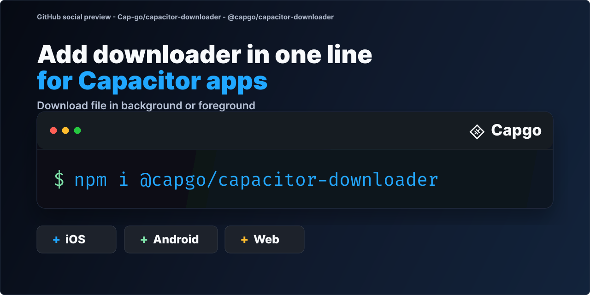

# @capgo/capacitor-downloader

Download large files in the background or foreground from your Capacitor app, with pause, resume and progress events. Downloads keep going when users leave the screen.

<a href="https://capgo.app/?ref=plugin_downloader"></a>

<div align="center">
  <p><b>Capgo</b>: push fixes to your Capacitor users in minutes, build signed iOS and Android apps without a Mac, and roll back in one click.</p>
  <h2><a href="https://capgo.app/register/?ref=plugin_downloader">➡️ Get started for free</a></h2>
  <p>14-day unlimited free trial. No credit card required</p>
</div>

> 🤖 **Building with an AI coding agent?** Install [Capgo skills](https://capgo.app/skills/?ref=plugin_downloader) so Claude Code, Codex, Cursor, Copilot, or Gemini CLI know how to install and use `@capgo/capacitor-downloader` in your Capacitor app: `npx skills add Cap-go/capgo-skills`. Then ask your agent: *"Add @capgo/capacitor-downloader to my Capacitor app and wire it up."* [Agent setup guides](https://capgo.app/agents/?ref=plugin_downloader) · [Hosted MCP](https://capgo.app/docs/ai/mcp/?ref=plugin_downloader)

<p align="center">
  
</p>

## Built and maintained with AI

We build, improve and fix our plugins with heavy use of AI, so issues usually get fixed in under a day and pull requests get feedback the same day. A human still reviews, tests and merges 50+ pull requests daily.

- Most plugin issues get a fix pull request the same day, often within a couple of hours, and are usually resolved in one to two days.
- Every pull request goes through our AI review system, usually within minutes.
- Our AI pre-checks tests, code review, conventions and security, then a human reviews, tests and merges.
- A human, Martin, reviews, tests and merges 50+ pull requests every day.
- In the last 90 days, 95% of plugin issues were resolved.

[Learn more about how we build with AI](https://capgo.app/docs/plugins/ai-engineering/)

## Key features

- **Downloads**: `download()` starts a task with optional HTTP headers and a `wifi-only` or cellular network rule.
- **Control**: `pause()`, `resume()` and `stop()` for each download ID.
- **Progress events**: `downloadProgress`, `downloadCompleted` and `downloadFailed` listeners.
- **Status and files**: `checkStatus()` for a task and `getFileInfo()` for a downloaded file.
- **Platforms**: iOS and Android. iOS uses a background `URLSession`. Android uses `DownloadManager` by default (same as earlier releases). **OkHttp** is opt in via `androidHttpEngine` for app-private destinations. Not available on web.
- **Android private storage**: set `androidHttpEngine: 'auto'` or `'okhttp'` and use `cache/...` or `files/...` for internal storage. `notification: 'hidden'` hides DownloadManager progress UI; `downloadCompletedNotificationText` can still alert on success.
- **Android notification copy (8.6.0)**: optional `title` and `description` on DownloadManager progress notifications (ignored on iOS, Web, and OkHttp).

## Android OkHttp engine (8.5.0)

**Opt in:** set `androidHttpEngine` to `'auto'` or `'okhttp'` for downloads into app-private storage (offline packs, encrypted assets, cache). When the option is omitted, every destination uses `DownloadManager` and legacy app external file paths, including existing `cache/...` and `files/...` strings.

```typescript
await CapacitorDownloader.download({
  id: 'offline-pack',
  url: 'https://cdn.example.com/pack.zip',
  destination: 'files/offline/pack.zip',
  androidHttpEngine: 'auto', // OkHttp for files/... and cache/...
  notification: 'hidden', // no system notification during transfer; listen to downloadProgress
});
```

| `androidHttpEngine` | Behavior |
| ------------------- | -------- |
| Omitted | DownloadManager only, legacy destination paths (matches pre-option releases) |
| `'auto'` | OkHttp for `cache/...`, `files/...`, and paths under internal cache/data/files; DownloadManager for external app storage and `public-downloads/...` |
| `'okhttp'` | Always OkHttp; rejects `public-downloads/...` paths |
| `'downloadManager'` | Always system DownloadManager with legacy destination paths |

**Android `destination` prefixes**

| Prefix | Storage when `androidHttpEngine` is `'auto'` or `'okhttp'` | Storage when option is omitted |
| ------ | ----------------------------------------------------------- | ------------------------------ |
| `cache/...` | App cache dir (OkHttp with `'auto'`) | App external files (DownloadManager) |
| `files/...` | App-private files dir (OkHttp with `'auto'`) | App external files (DownloadManager) |
| `public-downloads/...` | Public Downloads folder (DownloadManager) | App external files under `public-downloads/...` (DownloadManager) |
| Other relative paths | App external files dir (DownloadManager) | App external files dir (DownloadManager) |

**Notifications on OkHttp:** no notification during the transfer. Use `notification: 'hidden'` with `downloadProgress` events, or `'completed'` to post one completion-style notification when the file finishes (not on failure). DownloadManager paths still honor `completed`, `progress`, and `hidden` as before. `downloadCompletedNotificationText` is separate and can still post on success when set.

Full guide: https://capgo.app/docs/plugins/downloader/getting-started/#android-okhttp-engine

## Android DownloadManager notification title and description (8.6.0)

**Available since 8.6.0:** set `title` and `description` on `download()` so the Android DownloadManager progress notification shows a user-facing label instead of the raw destination file name. Omit either field (or pass empty text) to keep the system default. Applies only on the DownloadManager path; iOS, Web, and OkHttp Android downloads ignore both options.

```typescript
await CapacitorDownloader.download({
  id: 'offline-pack',
  url: 'https://cdn.example.com/large-pack.zip',
  destination: 'downloads/offline-pack.zip',
  notification: 'progress',
  title: 'Offline map pack',
  description: 'Downloading region data for offline use',
});
```

Full guide: https://capgo.app/docs/plugins/downloader/getting-started/#android-downloadmanager-notification-labels

## Download completed notifications

Long downloads often finish while your user is in another app. Set `downloadCompletedNotificationText` on `download()` to show an opt-in, caller-localized system notification when the file is ready. Tapping it returns to your app.

- **Opt in**: omit the option (or pass empty text) to rely on `downloadCompleted` events only.
- **Permissions**: request notification permission in your app. If the user denies it, downloads still complete and the plugin skips the alert.
- **Android**: the plugin manifest already merges `POST_NOTIFICATIONS`; on Android 13+ your app only needs to request it at runtime. Works alongside the DownloadManager `notification` visibility option. While your app is in the foreground, Android still posts the completion alert when the download succeeds.
- **iOS**: request authorization with `UNUserNotificationCenter` before the download finishes. While your app is in the foreground, iOS shows a delivered notification only if your app's `UNUserNotificationCenter` delegate presents it, so without a notifications plugin it is usually silent; use `downloadCompleted` events in that case.

```typescript
await Downloader.download({
  id: 'episode-12',
  url: audioUrl,
  destination: 'podcasts/episode-12.mp3',
  notification: 'hidden',
  downloadCompletedNotificationText: t('downloads.episodeReady'),
});
```

## Why Capacitor Downloader?

A reliable **native file downloader** built for Capacitor apps that continues downloads even when your app is backgrounded or closed:

- **Background downloads** - Downloads continue even when app is minimized, backgrounded, or closed (main advantage)
- **Progress tracking** - Real-time progress updates during downloads
- **Network control** - Choose between WiFi-only or cellular network downloads
- **Custom headers** - Add authentication tokens and custom HTTP headers
- **Resumable downloads** - Pause and resume downloads (platform dependent)
- **Event listeners** - Monitor download progress, completion, and failures
- **Large file support** - Handle multi-gigabyte files without memory issues
- **Free and open source** - No paid services required

Perfect for downloading large media files, offline content, app updates, and any scenario where downloads need to survive app lifecycle events.

## Documentation

The most complete doc is available here: https://capgo.app/docs/plugins/downloader/

## Compatibility

| Plugin version | Capacitor compatibility | Maintained |
| -------------- | ----------------------- | ---------- |
| v8.\*.\*       | v8.\*.\*                | ✅          |
| v7.\*.\*       | v7.\*.\*                | On demand   |
| v6.\*.\*       | v6.\*.\*                | ❌          |
| v5.\*.\*       | v5.\*.\*                | ❌          |

> **Note:** The major version of this plugin follows the major version of Capacitor. Use the version that matches your Capacitor installation (e.g., plugin v8 for Capacitor 8). Only the latest major version is actively maintained.

## Install

You can use our AI-Assisted Setup to install the plugin. Add the Capgo skills to your AI tool using the following command:

```bash
npx skills add https://github.com/cap-go/capacitor-skills --skill capacitor-plugins
```

Then use the following prompt:

```text
Use the `capacitor-plugins` skill from `cap-go/capacitor-skills` to install the `@capgo/capacitor-downloader` plugin in my project.
```

If you prefer Manual Setup, install the plugin by running the following commands and follow the platform-specific instructions below:

```bash
npm install @capgo/capacitor-downloader
npx cap sync
```

## API

<docgen-index>

* [`download(...)`](#download)
* [`pause(...)`](#pause)
* [`resume(...)`](#resume)
* [`stop(...)`](#stop)
* [`checkStatus(...)`](#checkstatus)
* [`getFileInfo(...)`](#getfileinfo)
* [`addListener('downloadProgress', ...)`](#addlistenerdownloadprogress-)
* [`addListener('downloadCompleted', ...)`](#addlistenerdownloadcompleted-)
* [`addListener('downloadFailed', ...)`](#addlistenerdownloadfailed-)
* [`removeAllListeners()`](#removealllisteners)
* [`getPluginVersion()`](#getpluginversion)
* [Interfaces](#interfaces)

</docgen-index>

<docgen-api>
<!--Update the source file JSDoc comments and rerun docgen to update the docs below-->

Capacitor plugin for downloading files with background support.
Provides resumable downloads with progress tracking.

### download(...)

```typescript
download(options: DownloadOptions) => Promise<DownloadTask>
```

Start a new download task.

| Param         | Type                                                        | Description              |
| ------------- | ----------------------------------------------------------- | ------------------------ |
| **`options`** | <code><a href="#downloadoptions">DownloadOptions</a></code> | - Download configuration |

**Returns:** <code>Promise&lt;<a href="#downloadtask">DownloadTask</a>&gt;</code>

--------------------


### pause(...)

```typescript
pause(options: { id: string; }) => Promise<void>
```

Pause an active download.
Download can be resumed later from the same position.

| Param         | Type                         | Description                               |
| ------------- | ---------------------------- | ----------------------------------------- |
| **`options`** | <code>{ id: string; }</code> | - Options containing the download task ID |

--------------------


### resume(...)

```typescript
resume(options: { id: string; }) => Promise<void>
```

Resume a paused download.
Continues from where it was paused.

| Param         | Type                         | Description                               |
| ------------- | ---------------------------- | ----------------------------------------- |
| **`options`** | <code>{ id: string; }</code> | - Options containing the download task ID |

--------------------


### stop(...)

```typescript
stop(options: { id: string; }) => Promise<void>
```

Stop and cancel a download permanently.
Downloaded data will be deleted.

| Param         | Type                         | Description                               |
| ------------- | ---------------------------- | ----------------------------------------- |
| **`options`** | <code>{ id: string; }</code> | - Options containing the download task ID |

--------------------


### checkStatus(...)

```typescript
checkStatus(options: { id: string; }) => Promise<DownloadTask>
```

Check the current status of a download.

| Param         | Type                         | Description                               |
| ------------- | ---------------------------- | ----------------------------------------- |
| **`options`** | <code>{ id: string; }</code> | - Options containing the download task ID |

**Returns:** <code>Promise&lt;<a href="#downloadtask">DownloadTask</a>&gt;</code>

--------------------


### getFileInfo(...)

```typescript
getFileInfo(options: { path: string; }) => Promise<{ size: number; type: string; }>
```

Get information about a downloaded file.

| Param         | Type                           | Description                        |
| ------------- | ------------------------------ | ---------------------------------- |
| **`options`** | <code>{ path: string; }</code> | - Options containing the file path |

**Returns:** <code>Promise&lt;{ size: number; type: string; }&gt;</code>

--------------------


### addListener('downloadProgress', ...)

```typescript
addListener(eventName: 'downloadProgress', listenerFunc: (progress: { id: string; progress: number; bytesWritten?: number | undefined; bytesTotal?: number | undefined; }) => void) => Promise<PluginListenerHandle>
```

Listen for download progress updates.
Fired periodically as download progresses.

| Param              | Type                                                                                                              | Description                           |
| ------------------ | ----------------------------------------------------------------------------------------------------------------- | ------------------------------------- |
| **`eventName`**    | <code>'downloadProgress'</code>                                                                                   | - Must be 'downloadProgress'          |
| **`listenerFunc`** | <code>(progress: { id: string; progress: number; bytesWritten?: number; bytesTotal?: number; }) =&gt; void</code> | - Callback receiving progress updates |

**Returns:** <code>Promise&lt;<a href="#pluginlistenerhandle">PluginListenerHandle</a>&gt;</code>

--------------------


### addListener('downloadCompleted', ...)

```typescript
addListener(eventName: 'downloadCompleted', listenerFunc: (result: { id: string; }) => void) => Promise<PluginListenerHandle>
```

Listen for download completion.
Fired when a download finishes successfully.

| Param              | Type                                              | Description                                  |
| ------------------ | ------------------------------------------------- | -------------------------------------------- |
| **`eventName`**    | <code>'downloadCompleted'</code>                  | - Must be 'downloadCompleted'                |
| **`listenerFunc`** | <code>(result: { id: string; }) =&gt; void</code> | - Callback receiving completion notification |

**Returns:** <code>Promise&lt;<a href="#pluginlistenerhandle">PluginListenerHandle</a>&gt;</code>

--------------------


### addListener('downloadFailed', ...)

```typescript
addListener(eventName: 'downloadFailed', listenerFunc: (error: { id: string; error: string; }) => void) => Promise<PluginListenerHandle>
```

Listen for download failures.
Fired when a download encounters an error.

| Param              | Type                                                            | Description                            |
| ------------------ | --------------------------------------------------------------- | -------------------------------------- |
| **`eventName`**    | <code>'downloadFailed'</code>                                   | - Must be 'downloadFailed'             |
| **`listenerFunc`** | <code>(error: { id: string; error: string; }) =&gt; void</code> | - Callback receiving error information |

**Returns:** <code>Promise&lt;<a href="#pluginlistenerhandle">PluginListenerHandle</a>&gt;</code>

--------------------


### removeAllListeners()

```typescript
removeAllListeners() => Promise<void>
```

Remove all event listeners.
Cleanup method to prevent memory leaks.

--------------------


### getPluginVersion()

```typescript
getPluginVersion() => Promise<{ version: string; }>
```

Get the plugin version number.

**Returns:** <code>Promise&lt;{ version: string; }&gt;</code>

--------------------


### Interfaces


#### DownloadTask

Represents the current state and progress of a download task.

| Prop           | Type                                                                 | Description                             |
| -------------- | -------------------------------------------------------------------- | --------------------------------------- |
| **`id`**       | <code>string</code>                                                  | Unique identifier for the download task |
| **`progress`** | <code>number</code>                                                  | Download progress from 0 to 100         |
| **`state`**    | <code>'PENDING' \| 'RUNNING' \| 'PAUSED' \| 'DONE' \| 'ERROR'</code> | Current state of the download           |


#### DownloadOptions

Configuration options for starting a download.

| Prop                                    | Type                                                 | Description                                                                                                                                                                                                                                                                                                                                                                                                                                                                                                                                                                                                                                                                                                                                                                                  | Since |
| --------------------------------------- | ---------------------------------------------------- | -------------------------------------------------------------------------------------------------------------------------------------------------------------------------------------------------------------------------------------------------------------------------------------------------------------------------------------------------------------------------------------------------------------------------------------------------------------------------------------------------------------------------------------------------------------------------------------------------------------------------------------------------------------------------------------------------------------------------------------------------------------------------------------------- | ----- |
| **`id`**                                | <code>string</code>                                  | Unique identifier for this download task                                                                                                                                                                                                                                                                                                                                                                                                                                                                                                                                                                                                                                                                                                                                                     |       |
| **`url`**                               | <code>string</code>                                  | URL of the file to download                                                                                                                                                                                                                                                                                                                                                                                                                                                                                                                                                                                                                                                                                                                                                                  |       |
| **`destination`**                       | <code>string</code>                                  | Local file path where the download will be saved. On Android, relative paths without `androidHttpEngine` behave like earlier releases: every relative path, including `cache/...` and `files/...`, is stored under app external files via DownloadManager. When you set `androidHttpEngine` to `'auto'` or `'okhttp'`, optional roots apply: - `cache/...` saves under app cache (OkHttp with `'auto'`). - `files/...` saves under app-private internal storage (OkHttp with `'auto'`). - `public-downloads/...` saves to the public Downloads folder (DownloadManager). - Any other relative path saves under app external files (DownloadManager with `'auto'`). Absolute paths and `file://` URIs are supported; `'auto'` picks OkHttp when the path is under cache, data, or files dirs. |       |
| **`headers`**                           | <code>{ [key: string]: string; }</code>              | Optional HTTP headers to include in the request                                                                                                                                                                                                                                                                                                                                                                                                                                                                                                                                                                                                                                                                                                                                              |       |
| **`network`**                           | <code>'cellular' \| 'wifi-only'</code>               | Network type requirement for download                                                                                                                                                                                                                                                                                                                                                                                                                                                                                                                                                                                                                                                                                                                                                        |       |
| **`priority`**                          | <code>'high' \| 'normal' \| 'low'</code>             | Download priority level                                                                                                                                                                                                                                                                                                                                                                                                                                                                                                                                                                                                                                                                                                                                                                      |       |
| **`notification`**                      | <code>'completed' \| 'progress' \| 'hidden'</code>   | Android DownloadManager notification visibility. - `'completed'` (default): show while downloading and keep the notification after completion. - `'progress'`: show while downloading, remove the notification when finished. - `'hidden'`: no DownloadManager progress notification; use plugin progress events instead. `downloadCompletedNotificationText` can still post a completion notification when the transfer succeeds. On the OkHttp Android path, notifications are not shown during the transfer. With `'completed'`, a single completion notification may be posted when the file finishes (Android 13+ requires runtime `POST_NOTIFICATIONS` in the host app). Ignored on iOS and Web.                                                                                       | 8.2.0 |
| **`title`**                             | <code>string</code>                                  | Title shown on the Android DownloadManager progress notification. When omitted or empty, the system uses its default (typically the destination file name). Ignored on iOS, Web, and the OkHttp Android download path.                                                                                                                                                                                                                                                                                                                                                                                                                                                                                                                                                                       | 8.6.0 |
| **`description`**                       | <code>string</code>                                  | Description shown on the Android DownloadManager progress notification. When omitted or empty, the system uses its default. Ignored on iOS, Web, and the OkHttp Android download path.                                                                                                                                                                                                                                                                                                                                                                                                                                                                                                                                                                                                       | 8.6.0 |
| **`androidHttpEngine`**                 | <code>'auto' \| 'okhttp' \| 'downloadManager'</code> | Android HTTP stack used for the download. - Omitted: always DownloadManager with legacy destination resolution (same as releases before this option). - `'auto'`: OkHttp for app-private destinations (`cache/...`, `files/...`, or an absolute path under cache/data/files when extended roots apply); DownloadManager for legacy relative paths under app external storage and `public-downloads/...`. - `'okhttp'`: always use OkHttp for extended-root destinations. Rejects `public-downloads/...` paths. Transfers run in the app process and do not continue after the process is killed (unlike DownloadManager on those paths). - `'downloadManager'`: always use the system DownloadManager with legacy destination resolution. Ignored on iOS and Web.                            | 8.5.0 |
| **`downloadCompletedNotificationText`** | <code>string</code>                                  | Optional localized text for a system notification when the download finishes. When set, iOS and Android may show a local notification after a successful download if the user granted notification permission. If permission is denied, the download still completes and no notification is shown. Tapping the notification reopens the app. Omitted or empty means no completion notification from the plugin (use `downloadCompleted` events while the app is open).                                                                                                                                                                                                                                                                                                                       | 8.5.0 |


#### PluginListenerHandle

| Prop         | Type                                      |
| ------------ | ----------------------------------------- |
| **`remove`** | <code>() =&gt; Promise&lt;void&gt;</code> |

</docgen-api>

### Credit

This plugin was inspired from: https://github.com/kesha-antonov/react-native-background-downloader
